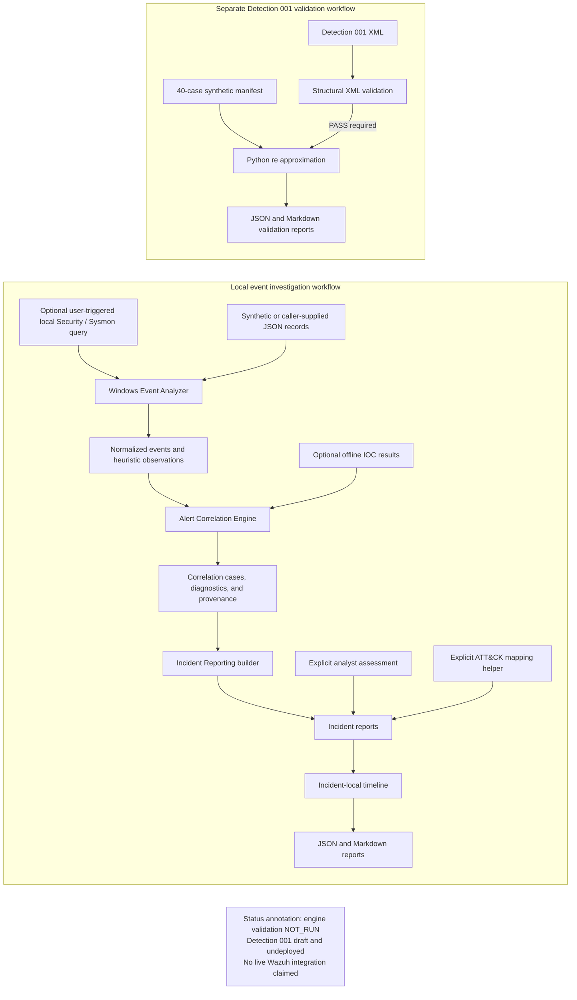

# SOC Sentinel

**I'm Saravana C, and I developed SOC Sentinel as a local Python portfolio project for analyzing supplied Windows/Sysmon event records, exercising a draft detection against synthetic cases, and preparing evidence-linked incident reports.**

The repository contains two independent workflows: incident investigation and local validation of Detection 001. Investigation can use supplied JSON records or an optional user-triggered snapshot of local Windows Security and Sysmon events. It does not provide continuous monitoring or claim live Wazuh validation.

## Contents

- [Project overview](#project-overview)
- [Capabilities](#capabilities)
- [Architecture](#architecture)
- [Engineering Decisions](#engineering-decisions)
- [Technology](#technology)
- [Repository layout](#repository-layout)
- [Stages 1–8](#stages-18)
- [Setup](#setup)
- [Run the available components](#run-the-available-components)
- [Synthetic investigation demonstrations](#synthetic-investigation-demonstrations)
- [Detection 001 validation workflow](#detection-001-validation-workflow)
- [Security boundaries and limitations](#security-boundaries-and-limitations)
- [Current status](#current-status)
- [Roadmap](#roadmap)
- [Contribution and authorship](#contribution-and-authorship)

## Project overview

I built the incident workflow to keep source data and analyst judgment distinct as events are normalized, correlated, placed on incident timelines, and reported. The separate Detection 001 workflow checks supported XML structure and compares a synthetic case manifest with a narrow Python `re` approximation. Synthetic results do not establish real-world detection efficacy.

## Capabilities

- **IOC enrichment:** validates IPv4/IPv6 addresses, domains, HTTP(S) URLs, and MD5/SHA-1/SHA-256 hashes. Offline synthetic results are the default. Optional VirusTotal metadata lookup requires explicit indicator-sharing acknowledgment.
- **Windows event analysis:** accepts supplied JSON records for Security Event IDs 4624 and 4625 and Sysmon Event IDs 1, 3, and 22. On Windows, an optional on-demand GUI can also read a bounded recent snapshot from the local Security and Sysmon event channels, then pass those records to the same analyzer. It preserves source records and reports heuristic investigation prompts.
- **Alert correlation:** correlates supported logon, process, network, and DNS patterns using normalized events, timestamps, identities, and explicitly supplied IOC results. It does not perform enrichment itself.
- **Incident reporting:** adapts correlation cases into incident reports, builds timelines, supports independent analyst-controlled severity and conclusion fields, supports explicit evidence-backed ATT&CK mappings, and exports JSON or Markdown.
- **Detection validation:** checks the supported structure of Detection 001 XML and evaluates the 40-case synthetic manifest with a narrow Python `re` approximation after structural validation passes.
- **Test coverage:** standard-library unit and integration tests exercise synthetic inputs, model validation, provenance, serialization, and documented limitations.

## Architecture

The repository contains two local workflows. Event analysis and incident reporting consume supplied JSON records; Detection 001 validation consumes its XML rule and synthetic case manifest. The workflows do not depend on a live Wazuh Manager.



IOC values are supplied to the correlation engine; it does not contact an enrichment provider. Analyst severity, conclusion, and ATT&CK mappings are explicit inputs, not automatic consequences of confidence or an IOC match. The Stage 8 workflow is separate from the incident investigation workflow.

## Engineering Decisions

- **Keep original event time and sort consistently.** Incident timelines sort using normalized UTC timestamps while retaining the original timestamp strings and event references. See the [timeline implementation](python/incident_reporting/timeline.py) and [architecture guide](docs/ARCHITECTURE.md).
- **Separate correlation from analyst assessment.** Severity and analyst conclusion are explicit, independently assigned fields; correlation confidence does not set either one. The [Stage 7 case study](investigations/007-suspicious-powershell-case-study.md) shows the distinction in use.
- **Tie ATT&CK mappings to evidence without overstating verification.** Mappings retain related-event references and remain `UNVERIFIED` because the project has no pinned ATT&CK catalogue. See the [mapping helper](python/incident_reporting/attack_mapping.py) and [architecture guide](docs/ARCHITECTURE.md).
- **Keep detection checks in separate layers.** Detection 001 structural validation is distinct from the Python `re` approximation; neither is Wazuh rule-engine validation, which remains `NOT_RUN`. See the [Stage 8 workflow report](investigations/008-detection-001-validation-workflow.md).

## Technology

| Purpose | Technology |
|---|---|
| Implementation | Python 3.10 or later; Python standard library |
| License | [Apache License 2.0](LICENSE) |
| Input and rule formats | JSON and XML |
| Local tests | `unittest` |
| Detection expression approximation | Python `re` only; not PCRE2 |
| Endpoint telemetry artifacts | Windows Security and Sysmon event formats; Sysmon configuration files are included |
| Detection content | Wazuh-compatible XML draft for Detection 001; not deployed or rule-engine validated |
| Investigation framework | MITRE ATT&CK identifiers supplied explicitly; Stage 7 mapping remains marked `UNVERIFIED` |

`requirements.txt` currently contains no installable third-party dependencies. No package installation is required for the documented local workflows.

## Repository layout

| Path | Purpose |
|---|---|
| [`docs/ARCHITECTURE.md`](docs/ARCHITECTURE.md) | Actual architecture of the two independent local workflows |
| [`architecture/`](architecture/architecture.md) | High-level architecture notes; deployment diagram is design context, not proof of a working live stack |
| [`detections/`](detections/001-suspicious-powershell-encoded-command.md) | Detection 001 rationale and other detection notes |
| [`investigations/`](investigations/007-suspicious-powershell-case-study.md) | Synthetic Stage 7 investigation and Stage 8 validation report |
| [`python/ioc_enrichment/`](python/ioc_enrichment/) | Indicator classification, validation, providers, orchestration, formatting, and CLI |
| [`python/windows_event_analyzer/`](python/windows_event_analyzer/) | Local read-only event collection GUI, supported-event normalization, heuristic observations, formatting, and JSON-input CLI |
| [`python/alert_correlation/`](python/alert_correlation/) | Correlation models, engine, and case formatting |
| [`python/incident_reporting/`](python/incident_reporting/) | Incident models, builder, timeline, ATT&CK helper, and report formatters |
| [`python/detection_validation/`](python/detection_validation/) | Detection manifest models, structural XML validator, Python approximation runner, and report formatters |
| [`python/tests/`](python/tests/) | Unit and end-to-end tests for Python packages |
| [`sysmon/configuration/`](sysmon/configuration/README.md) | Sysmon configuration artifact and its notes |
| [`tests/`](tests/README.md) | Detection test plan and synthetic case manifest |
| [`tests/fixtures/`](tests/fixtures/detection-001-cases.json) | Detection 001’s 40 synthetic validation cases |
| [`wazuh/custom-rules/`](wazuh/custom-rules/README.md) | Custom rule documentation and Detection 001 XML draft |
| [`reports/`](reports/README.md) | Guidance for sanitized reports; reports should not expose private endpoint data |

Manual investigation worksheets (analyst-completed templates, not automated reports):

- [Authentication investigation worksheet (manual template)](investigations/authentication-investigation.md)
- [Process investigation worksheet (manual template)](investigations/process-investigation.md)
- [Network investigation worksheet (manual template)](investigations/network-investigation.md)

## Stages 1–8

| Stage | Delivered capability | Scope and status |
|---|---|---|
| 1 | Incident report models and correlation-case adapter | Preserves incident and collection-level context separately. |
| 2 | Timeline construction | Builds incident-local timelines from related events, retaining original timestamps and provenance. |
| 3 | Severity and analyst conclusion | Keeps severity, conclusion, confidence, and rationales distinct; assessment values are explicit. |
| 4 | Evidence-backed ATT&CK mapping | Requires analyst-supplied technique details and related-event references; mappings remain `UNVERIFIED` without a pinned catalogue. |
| 5 | Incident JSON and Markdown formatters | JSON preserves raw evidence with explicit serialization markers; Markdown is a concise analyst view. |
| 6 | End-to-end incident scenarios | Synthetic benign, suspicious, malicious-assessment, and inconclusive scenarios exercise existing APIs. |
| 7 | Practical SOC investigation demonstration | Synthetic PowerShell/process/network/DNS investigation with offline IOC fixtures and explicit analyst assessment. |
| 8 | Detection validation workflow | Structural XML validation plus a limited Python regex approximation over 40 synthetic Detection 001 cases. |

Stages 6–8 are local synthetic demonstrations. They do not establish that the rule fired on a real endpoint or that the Wazuh engine behaves as approximated.

## Setup

Use Python 3.10 or later. Clone the repository using your authorized GitHub access, then open a terminal in the project’s `python` directory. There is no package installer step for the current standard-library implementation.

```powershell
cd "C:\path\to\SOC-Sentinel\python"
python --version
```

Commands below are intended to be run from `python/`, unless stated otherwise. The examples use supplied synthetic data or reserved documentation indicators.

## Run the available components

### IOC enrichment (offline by default)

```powershell
python -m ioc_enrichment.cli 198.51.100.10
python -m ioc_enrichment.cli suspicious.example --json
```

The offline provider returns labeled synthetic fixture results or a synthetic unknown result. These are not threat-intelligence findings.

### Windows Security Event Analyzer

Analyze the included synthetic event sample:

```powershell
python -m windows_event_analyzer.cli --input windows_event_analyzer/examples/synthetic_events.json
python -m windows_event_analyzer.cli --input windows_event_analyzer/examples/synthetic_events.json --format json
```

The CLI also accepts `--failed-logon-threshold` and `--failed-logon-window-seconds`. It analyzes supplied JSON; it does not read Windows Event Logs directly or change endpoint configuration.

On Windows, the optional local event review screen reads a bounded snapshot from the local Security and Sysmon Operational channels when you click **Collect and analyze**. It queries only Security IDs 4624/4625 and Sysmon IDs 1/3/22, for a selected look-back period and event cap. The screen is read-only, does not run continuously, does not change event logs, and makes no network requests. It uses Windows' built-in `wevtutil` query utility internally; you do not need to type a collection command. Double-click `python/SOC-Sentinel-Local-Events.pyw` from File Explorer to open the screen (requires a Windows Python file association). Access depends on your Windows account's permissions; the application does not elevate itself. The detail view stays in memory. JSON export is optional and warns that original event data may contain sensitive information.

### Correlation and incident reporting APIs

Correlation and incident reporting are Python APIs, not command-line applications. This minimal local sequence uses the included analyzer fixture:

```python
import json
from pathlib import Path

from alert_correlation import correlate
from incident_reporting import (
    build_incident_report_collection,
    format_json,
    format_markdown,
)
from incident_reporting.timeline import build_timelined_collection
from windows_event_analyzer import analyze_records

synthetic_event_records = json.loads(
    Path("windows_event_analyzer/examples/synthetic_events.json").read_text(encoding="utf-8")
)
existing_ioc_results = []  # Deliberately no IOC matches in this example.

analysis = analyze_records(synthetic_event_records)
cases = correlate(analysis, ioc_results=existing_ioc_results)
collection = build_incident_report_collection(cases)
collection = build_timelined_collection(collection)

print(format_markdown(collection))
# JSON retains raw source evidence; review before sharing.
json_text = format_json(collection)
```

This example reads the included synthetic event fixture and supplies an empty IOC result list, so IOC-based patterns have no match input. The fixture exercises event analysis but does not represent a correlatable incident sequence; this exact example currently produces an empty case collection. For IOC-based patterns, pass explicitly created IOC enrichment results; the correlation engine itself does not call enrichment. The models keep confidence separate from analyst-assigned severity and conclusion; no assessment is inferred by this example.

To explicitly attach an ATT&CK mapping, use `incident_reporting.add_attack_mapping()` with a technique ID/name, rationale, and related-event indices. Syntax validation is not catalogue verification; the mapping’s reference status remains `UNVERIFIED`.

### Stage 8 Detection 001 validation

There is no Stage 8 CLI yet. From `python/`, the public API can be called directly:

```python
from pathlib import Path

from detection_validation import (
    format_json,
    format_markdown,
    load_manifest,
    run_manifest_approximation,
    validate_detection_001_xml,
)

root = Path("..")
xml_path = root / "wazuh" / "custom-rules" / "100100-suspicious-powershell.xml"
manifest_path = root / "tests" / "fixtures" / "detection-001-cases.json"

structural = validate_detection_001_xml(xml_path)
report = run_manifest_approximation(manifest_path, xml_path, structural)
print(format_markdown(report))
json_text = format_json(report)
assert report.wazuh_engine_status.value == "not_run"
```

The runner structurally validates the current bounded XML input and only approximates expressions with Python `re` when structure passes. `load_manifest()` is also available when cases are needed separately. A structural or approximation result does not represent a Wazuh engine result.

**Platform scope:** Stage 8 structural XML validation currently requires Windows because its path-safety checks fail closed on unsupported platforms. This restriction applies to that validation workflow; it does not automatically apply to every SOC Sentinel package. Other packages may be usable on other platforms, subject to their own dependencies and behavior. No general cross-platform compatibility claim is made.

## Synthetic investigation demonstrations

- [Stage 7 case study](investigations/007-suspicious-powershell-case-study.md) walks through an inert encoded-command string, synthetic logon/process/network/DNS records, offline IOC fixtures, correlations, provenance, limitations, and an explicit `SUSPICIOUS` / `MEDIUM` training assessment. The analyst composition in that test is not automatic engine behavior.
- [Stage 7 screenshot gallery](docs/STAGE7-DEMO.md) presents the synthetic investigation as a rendered visual walkthrough.
- [Stage 8 workflow report](investigations/008-detection-001-validation-workflow.md) documents the Detection 001 structural and 40-case approximation result, including its limits.
- [Detection 001 test plan](tests/detection-001-suspicious-powershell-encoded-command.md) records synthetic positive, negative, mismatch, launcher-option, and false-positive-context expectations.

The Stage 7 screenshots show synthetic documentation, not a live Wazuh console or endpoint activity.

The files in [`reports/stage-007/`](reports/stage-007/) are synthetic demonstration artifacts, not live incident records. The JSON report preserves event evidence. Real investigation reports may contain sensitive information; sanitize them and review for privacy and authorization before publication.

## Detection 001 validation workflow

Detection 001 is a draft for Wazuh rule ID `100100`, level `10`, intended to alert on a Sysmon Event ID 1 PowerShell encoded-command invocation pattern. Its XML and test plan are in [`wazuh/custom-rules/`](wazuh/custom-rules/100100-suspicious-powershell.xml), [`detections/`](detections/001-suspicious-powershell-encoded-command.md), and [`tests/`](tests/detection-001-suspicious-powershell-encoded-command.md).

The local workflow checks the XML against a narrow supported structure, then compares the 40 synthetic cases with a Python `re` approximation. In the documented run, 40/40 expected comparisons passed: 27 positive, 10 negative, and 3 false-positive-context cases. The supplied `sysmon_event1` group is synthetic test input, not proof that a real Wazuh decoder assigns that group.

**Wazuh rule-engine validation remains `NOT_RUN`.** Python regex approximation is not PCRE2 execution and does not establish Wazuh decoder behavior or rule-engine compatibility. No live Wazuh Manager validation is claimed, and the rule has not been deployed.

## Security boundaries and limitations

- Synthetic cases are test data; they do not represent real attacks, real threat intelligence, or confirmed endpoint events. Command-line strings are inert and are never launched or decoded by the documented workflows.
- The Windows Event Analyzer processes caller-supplied JSON, not live event channels. Its observations are heuristic prompts, not maliciousness verdicts.
- IOC enrichment is offline and synthetic by default. Optional VirusTotal lookups are a separate, explicit action that discloses the selected indicator; only use them when sharing is authorized. The project’s tests use no live requests. See [Python usage and privacy guidance](python/README.md).
- Correlation confidence, IOC reputation, ATT&CK mappings, severity, and analyst conclusion are separate concepts. ATT&CK mappings in the demonstration are `UNVERIFIED`; mappings do not prove maliciousness.
- JSON incident exports preserve original evidence and may contain sensitive data such as usernames, host details, command lines, or credentials. Review and sanitize exports before sharing. Markdown summaries omit raw source records by default.
- Detection 001 is a draft and is not deployed. Wazuh rule-engine validation is `NOT_RUN`; no live Wazuh Manager validation is claimed. Python `re` results are not proof of PCRE2 compatibility.
- This repository does not provide continuous monitoring, a production SIEM service, automated blocking, process termination, account disabling, or other active response.
- The XML validator is a local structural check, not a complete Wazuh parser. Its Windows path checks are not atomic against concurrent path replacement; see the Stage 8 report for the documented limitation.

## Current status

- **Implemented:** Python packages for IOC validation/enrichment, offline Windows event analysis, correlation, incident reporting, timeline construction, and Detection 001 structural/approximation validation.
- **Demonstrated:** Stages 6 and 7 synthetic end-to-end tests and an analyst-oriented case study.
- **Detection 001:** local draft; undeployed.
- **Wazuh engine:** `NOT_RUN`.
- **Live monitoring:** not provided or claimed.
- **Dependencies:** standard library only for current Python modules; no third-party install is required.
- **Tests:** run locally with the command below; results depend on the current checkout and Python environment.

## Roadmap

These are future possibilities, not current features:

1. Perform genuine Detection 001 validation with `wazuh-logtest` in a suitable isolated Wazuh 4.14.1 environment, if one becomes available and is approved.
2. Expand synthetic detection manifests and structural contracts for additional rules.
3. Improve analyst documentation and add sanitized visuals only when they can be clearly distinguished from live telemetry.
4. Reassess any additional automation or operational integration as a separately scoped and reviewed project phase.

No roadmap item should be read as deployed or validated functionality.

## Run tests

From the `python/` directory:

```powershell
python -B -m unittest discover -s tests -v
```

The suite uses synthetic fixtures and mocked external responses. It does not require a Wazuh Manager, contact VirusTotal, or execute fixture command lines. The detection-validation formatter tests do not constitute Wazuh validation.

## Contribution and authorship

This is my cybersecurity portfolio project. The source, tests, fixtures, and investigation documents let reviewers trace the demonstrations back to their implementation. Start with the [architecture guide](docs/ARCHITECTURE.md), the [Stage 7 investigation](investigations/007-suspicious-powershell-case-study.md), or the [Stage 8 workflow report](investigations/008-detection-001-validation-workflow.md).
