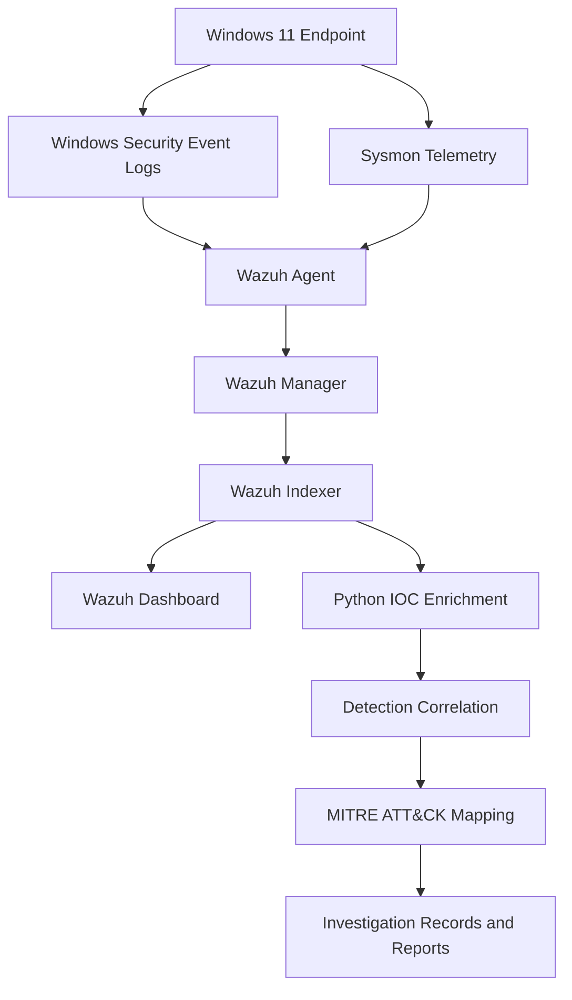

# SOC Sentinel Architecture

> **Design context only:** The diagram below is a conceptual deployment design. It is not a verified or currently implemented live Wazuh deployment. For the architecture of the implemented local workflows, see [docs/ARCHITECTURE.md](../docs/ARCHITECTURE.md).

The Windows endpoint produces security telemetry. The Wazuh Agent forwards configured events to the Wazuh Manager for decoding and rule evaluation. Alerts and state data are stored in the Indexer and viewed in the Dashboard. Python enrichment and analyst correlation support investigation and reporting.
