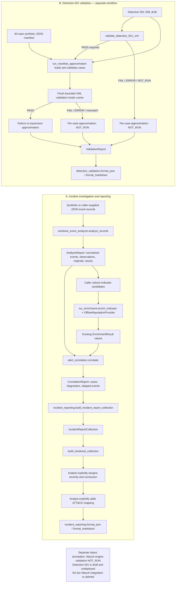
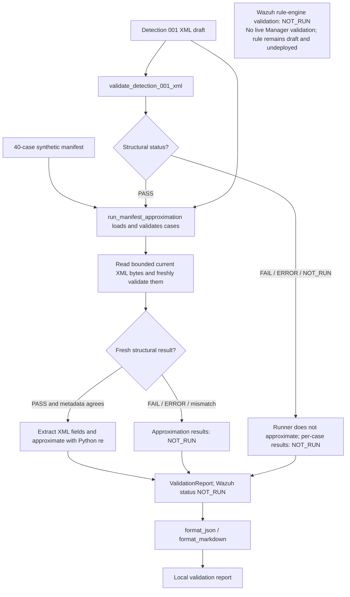

# SOC Sentinel Architecture

This document describes the two implemented local workflows in SOC Sentinel. They are independent: the incident investigation workflow consumes supplied event records, while Detection 001 validation consumes a rule XML file and a synthetic case manifest. Neither workflow requires or invokes a live Wazuh Manager.

The diagrams describe available package behavior, not a production deployment. Synthetic records are examples and tests; the analyzer can also be called with records supplied by an authorized caller. It does not collect Windows events itself.

## 1. Overall architecture

The incident workflow runs locally over supplied event data. The caller may use the `OfflineReputationProvider` to create synthetic enrichment results and pass those results to the correlator. Enrichment is not called by the correlation engine. Detection 001 validation does not feed into incident correlation; its output is a separate validation report.

The Wazuh status node is intentionally disconnected from both flows. The report model records Wazuh engine status as `NOT_RUN`; no rule engine or live Manager is invoked.

## 2. Incident investigation workflow

```mermaid
flowchart LR
    EventRecords["JSON event records"] --> Analyze["analyze_records"]
    Analyze --> Analysis["AnalysisReport"]
    Analysis --> CandidateSelection["Caller selects indicator values"]
    CandidateSelection --> Enrich["enrich_indicator with OfflineReputationProvider"]
    Enrich --> EnrichmentResults["EnrichmentResult list"]
    Analysis --> Correlate["correlate(AnalysisReport, ioc_results)"]
    EnrichmentResults --> Correlate
    Correlate --> CorrelationOutput["CorrelationReport and InvestigationCase values"]
    CorrelationOutput --> Build["build_incident_report_collection"]
    Build --> Incidents["IncidentReportCollection"]
    Incidents --> Timeline["build_timelined_collection"]
    Timeline --> AnalystAssessment["Analyst sets severity, conclusion, and separate rationales"]
    AnalystAssessment --> AttackMapping["Analyst calls add_attack_mapping with event references"]
    AttackMapping --> Export["format_json / format_markdown"]
```

| Component | Input and output | Role, automation, and limitation |
|---|---|---|
| `windows_event_analyzer.analyze_records` | Accepts an iterable of event mappings; returns an `AnalysisReport` with supported normalized events, original input records, and input issues. | Normalizes Windows Security 4624/4625 and Sysmon 1/3/22 records and adds heuristic investigation observations. It reads supplied records; it does not subscribe to Windows event channels. Observations are not maliciousness verdicts. |
| IOC classification, validation, and enrichment | `enrich_indicator(value, provider=...)` returns an `EnrichmentResult`. The workflow can pass candidates from normalized fields or raw evidence. | `OfflineReputationProvider` returns synthetic examples and makes no network request. Candidate selection is caller-controlled; not every raw field, such as process hashes in the Stage 7 fixture, is normalized by the analyzer. Optional live VirusTotal lookup is separate and requires explicit indicator-sharing acknowledgment; it is not part of this diagram’s offline path. |
| `alert_correlation.correlate` | Accepts an `AnalysisReport` or normalized events and optional existing IOC results; returns a list-compatible `CorrelationReport`. | Creates supported logon, process, network, and DNS investigation cases, along with diagnostics and skipped-event information. It does not perform enrichment. Correlation confidence describes evidence linkage, not incident severity or a confirmed attack. |
| Incident builder and timeline | The builder converts cases to an `IncidentReportCollection`; `build_timelined_collection` returns a collection with per-incident timelines. | Original source batches and collection-level context stay at collection level; each timeline uses only its incident’s related events. Timestamps are not invented. |
| Analyst assessment | The analyst assigns incident severity, conclusion, and independent rationales on the incident model. | These fields default to `NOT_ASSESSED`. They are not inferred from confidence, IOC status, event counts, or recommendations. This is a human decision, not an automated pipeline result. |
| ATT&CK mapping helper | `add_attack_mapping` receives an incident, a technique ID/name, rationale, and related-event indices. | A mapping is explicitly supplied and tied to incident-local events. The current helper validates ID syntax but has no pinned ATT&CK catalogue; `reference_status` remains `UNVERIFIED`. A mapping does not establish maliciousness. |
| Incident formatters | `format_json` and `format_markdown` accept an incident or collection. | JSON preserves modeled evidence and reports serialization limitations; review it before sharing because raw records may contain sensitive data. Markdown is a concise summary and does not expand raw records by default. Neither formatter performs response actions. |

### Orchestration boundary

The package APIs are composable functions, not one automatic service. The Stage 7 demonstration calls the analyzer, explicitly selects IOC candidates, supplies `OfflineReputationProvider` results, correlates cases, and then performs a **test-only analyst composition** of the separate cases for the case study. That composition is not behavior of `correlate()`. It then assigns the training assessment and mapping explicitly. The diagrams show the supported component sequence and caller-controlled handoffs; they do not imply that the engine makes analyst decisions.

The investigation fixture is synthetic. The documented workflow does not execute command lines, decode payloads, scan networks, or contact VirusTotal. No live Wazuh alert or endpoint investigation is represented.

## 3. Detection 001 validation workflow

`load_manifest()` validates the 40-case manifest and preserves its order. The public workflow first calls `validate_detection_001_xml()`. If that supplied result is not `PASS`, `run_manifest_approximation()` returns explicit per-case `NOT_RUN` results and does not open the XML. If it is `PASS`, the runner reads bounded XML bytes, freshly validates those bytes, checks the metadata, and only then extracts and evaluates the field expressions.

| Structural / runner condition | Approximation behavior | Report meaning |
|---|---|---|
| Initial structural `PASS`; the runner’s fresh bounded XML validation and metadata checks pass | Evaluates every manifest case using the supported Python `re` subset. | Per-case comparisons can be `PASS` or `FAIL`. The model also represents unsupported/error branches, which are covered with isolated tests; unsupported or malformed XML cannot pass the public structural prerequisite. |
| Initial structural `FAIL`, `ERROR`, or `NOT_RUN` | The public runner does not evaluate expressions and returns `NOT_RUN` for each case. | Structural status and approximation status remain separate. |
| Initial result was `PASS`, but fresh XML validation or metadata checks do not pass | Does not evaluate expressions; returns per-case `NOT_RUN`. | A stale or mismatched structural result cannot authorize approximation of changed XML. |

The approximation uses Python’s standard `re` engine and a deliberately narrow supported subset. Python regex behavior is not PCRE2 behavior and does not establish Wazuh decoder or rule-engine semantics. The supplied `sysmon_event1` group in each case is synthetic input, not proof that a real decoder assigns that group. A structural `PASS` and 40 successful approximation comparisons are local validation results only. Unsupported-expression and malformed-expression result branches are exercised through isolated compiler/runner tests; they do not show that unsupported or malformed XML passed through the normal public workflow.

The Wazuh status annotation is **`NOT_RUN`**. Detection 001 remains a draft and is undeployed. The validation package does not invoke `wazuh-logtest`, start a Manager, deploy a rule, or perform live Wazuh validation.

## Verified component inventory

- `windows_event_analyzer`: `analyze_records`, `analyze_json`, normalized-event and analysis-report models, text/JSON formatters, and a JSON-input CLI.
- `ioc_enrichment`: indicator classification and validation, `enrich_indicator`, synthetic `OfflineReputationProvider`, optional explicit VirusTotal provider, and text/JSON formatters.
- `alert_correlation`: `correlate`, `CorrelationConfig`, investigation-case models, list-compatible `CorrelationReport`, and case formatters.
- `incident_reporting`: correlation adapter, incident and collection models, `build_timeline` / `build_timelined_collection`, `add_attack_mapping`, and JSON/Markdown formatters.
- `detection_validation`: `load_manifest`, `validate_detection_001_xml`, `run_manifest_approximation`, separate structural/approximation/Wazuh status models, and JSON/Markdown formatters.

## Source references

- [Root README](../README.md) — project scope, two workflows, setup, and current limitations.
- [Python package guide](../python/README.md) — package capabilities, command examples, and privacy guidance.
- [Stage 7 synthetic investigation](../investigations/007-suspicious-powershell-case-study.md) — end-to-end use of the real APIs and the test-only composition boundary.
- [Stage 8 validation workflow](../investigations/008-detection-001-validation-workflow.md) — structural and approximation results and validation limits.
- [Detection 001 rule](../wazuh/custom-rules/100100-suspicious-powershell.xml) and [test plan](../tests/detection-001-suspicious-powershell-encoded-command.md) — rule intent and synthetic cases.
- Package implementations and integration coverage under `python/` — public exports, signatures, models, and tests.

No diagram represents a live Wazuh Manager, continuous monitoring, production deployment, or automated response. The included architecture notes do not establish that these services are currently connected or operational.
