# Stage 7 — Synthetic SOC Investigation

This visual walkthrough follows the [Stage 7 case study](../investigations/007-suspicious-powershell-case-study.md) from initial scope through the analyst's final assessment.

> **Scope:** Synthetic training data only. This is not a live Wazuh alert or endpoint investigation. No live Wazuh alert or rule-engine validation was performed, no command or payload was executed, and no external IOC lookup was made. The ATT&CK mapping remains `UNVERIFIED`. Process, network, and DNS associations are hypotheses where documented, not confirmed links.

## Alert and scope

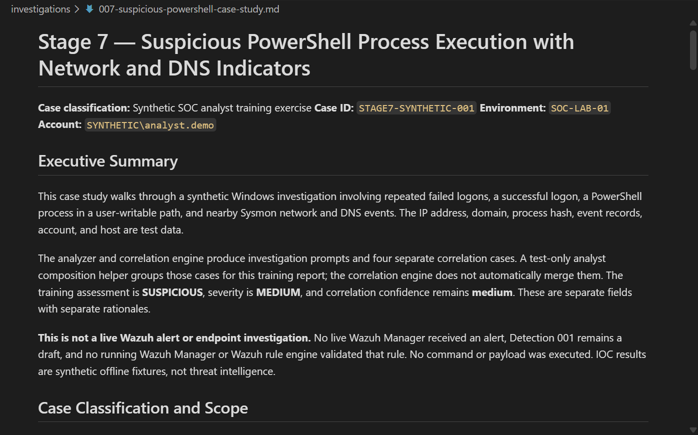

*Executive summary and exercise boundaries.*

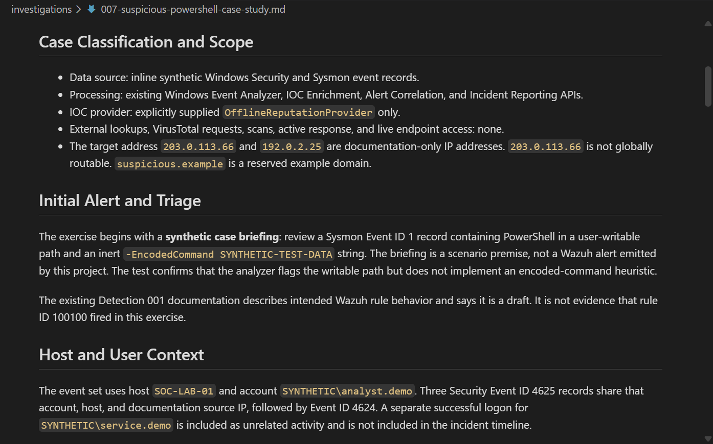

*Synthetic input scope, initial triage, and host/account context.*

## Process and network investigation

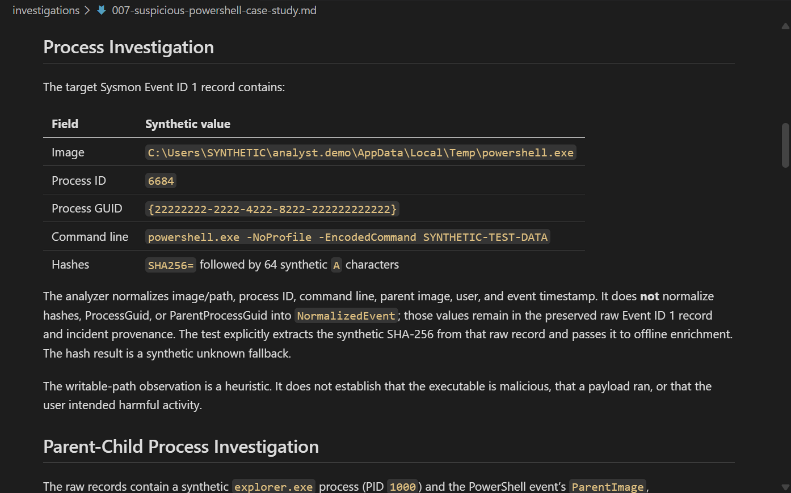

*PowerShell process fields preserved in the synthetic Event ID 1 evidence.*

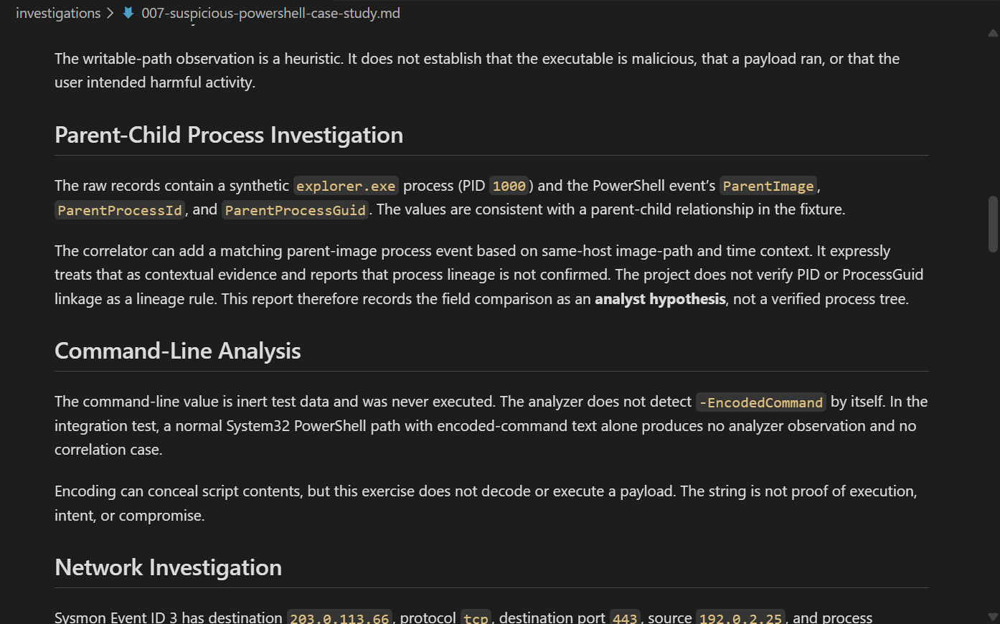

*Parent context and inert command-line assessment.*

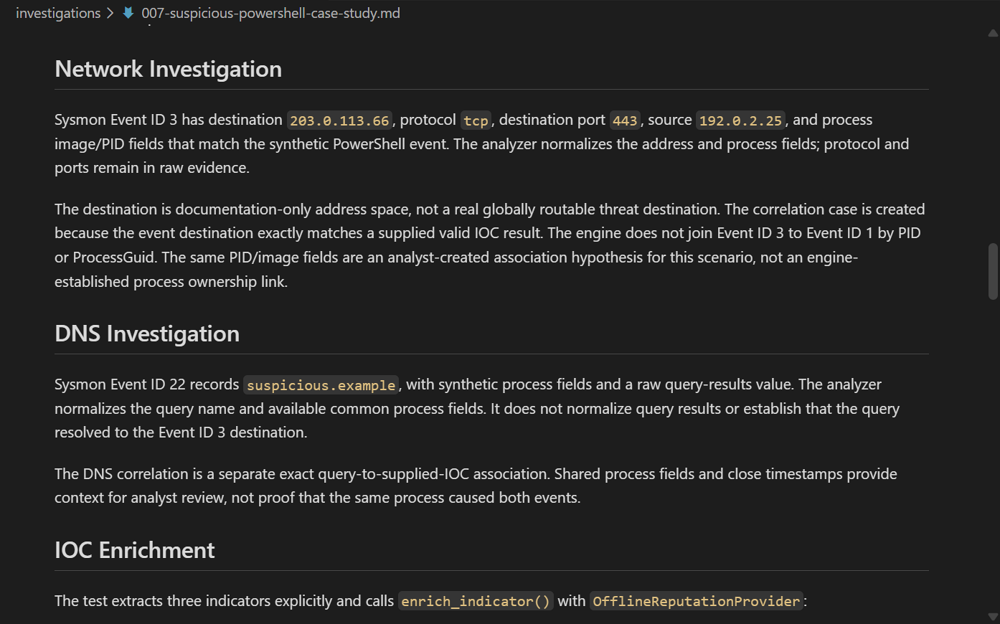

*Network and DNS observations, with association limits.*

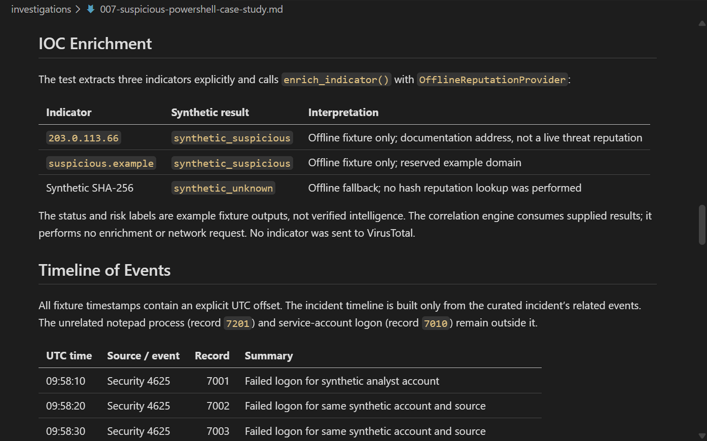

*Offline synthetic IOC results and the beginning of the event timeline.*

## Timeline and correlation

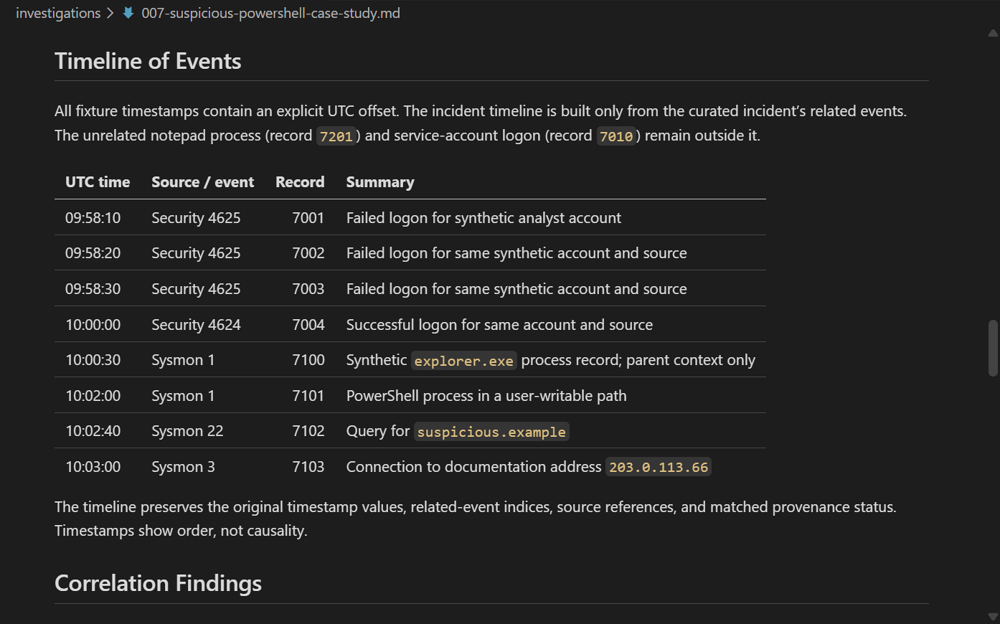

*Incident timeline; timestamps establish ordering, not causality.*

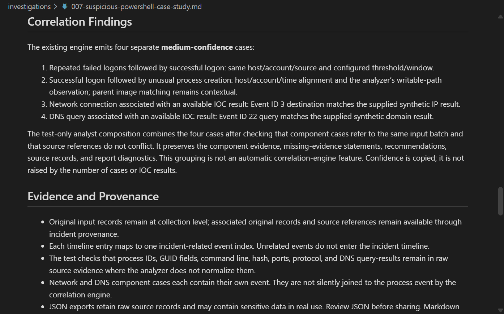

*Four separate engine correlation cases and test-only report composition.*

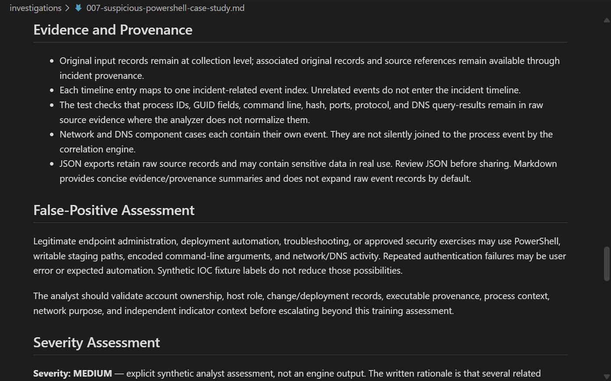

*Evidence provenance and benign explanations to consider.*

## Assessment and next steps

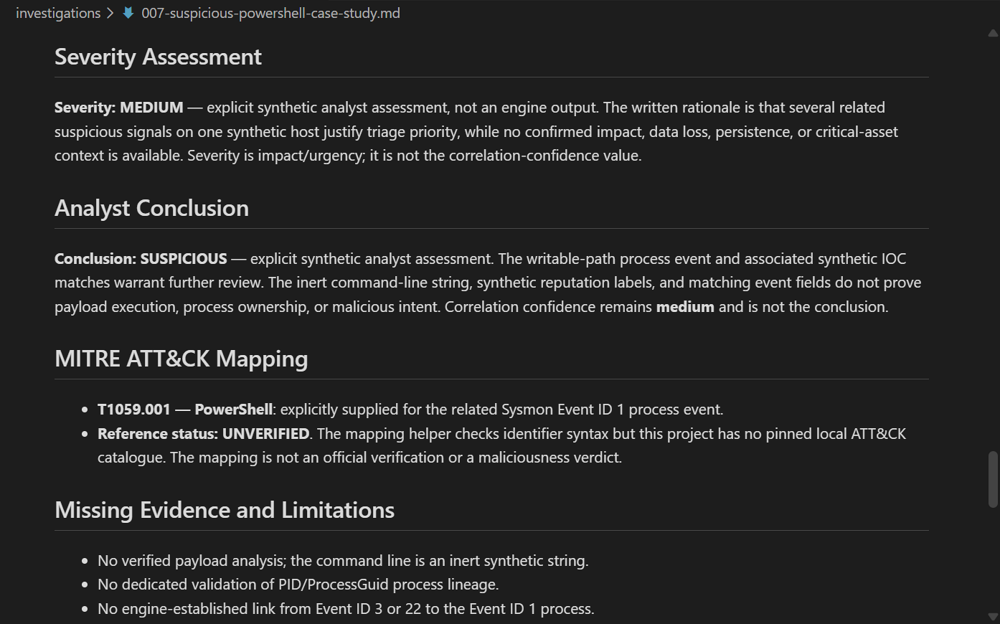

*Separate analyst severity and conclusion; ATT&CK mapping remains `UNVERIFIED`.*

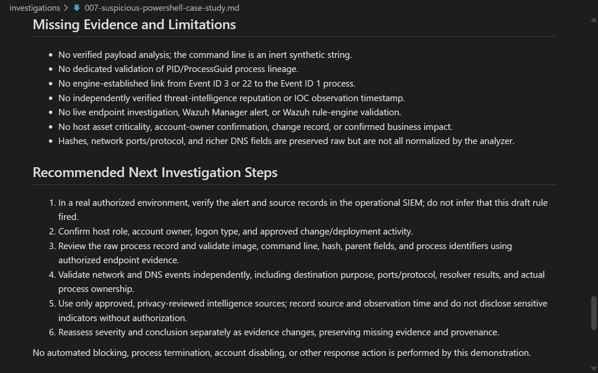

*Missing evidence and recommended investigation steps.*
